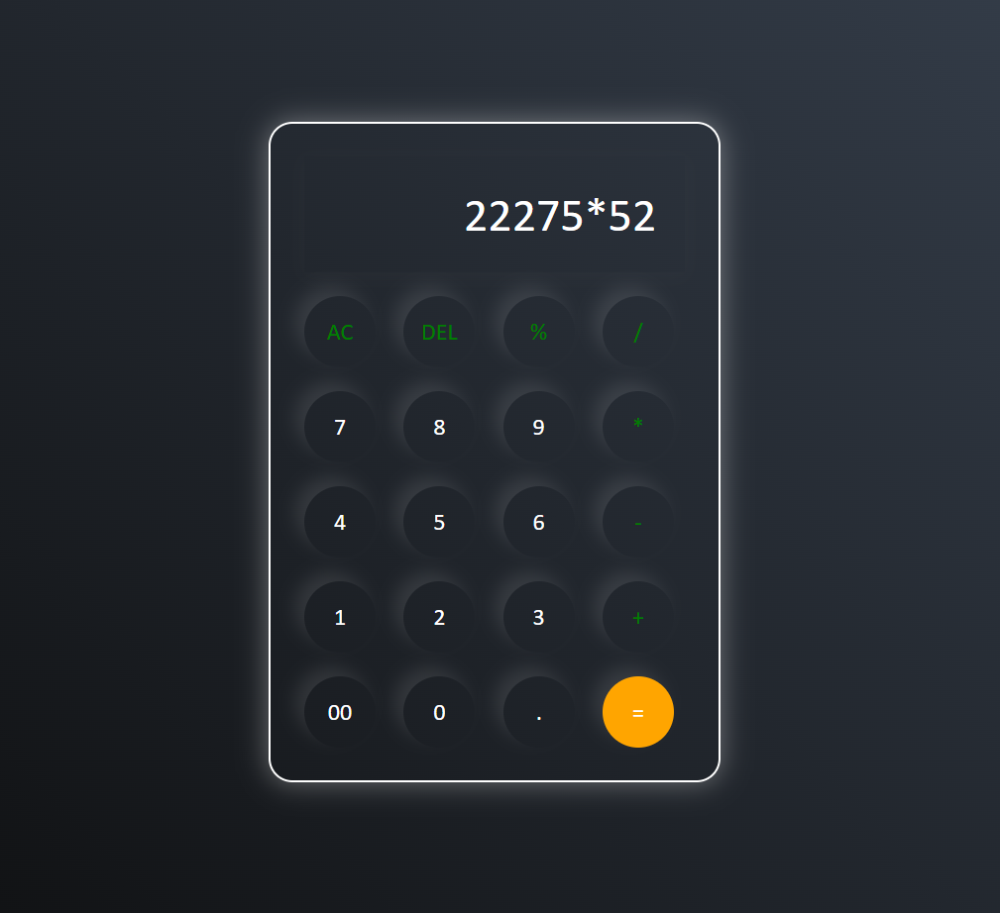

**********Project Description**********

An interactive web calculator built using HTML, CSS, and JavaScript to perform basic arithmetic operations.

## 🚀 Features

- Addition, subtraction, multiplication, and division.
- Interactive buttons.
- Dynamic display updates.
- Responsive design.

## 📸 Screenshots

### Layout

## 👨‍💻 Author

Syed Taha Bukhari

GitHub: 

LinkedIn: 

Email: tahabukhari175@gmail.com

